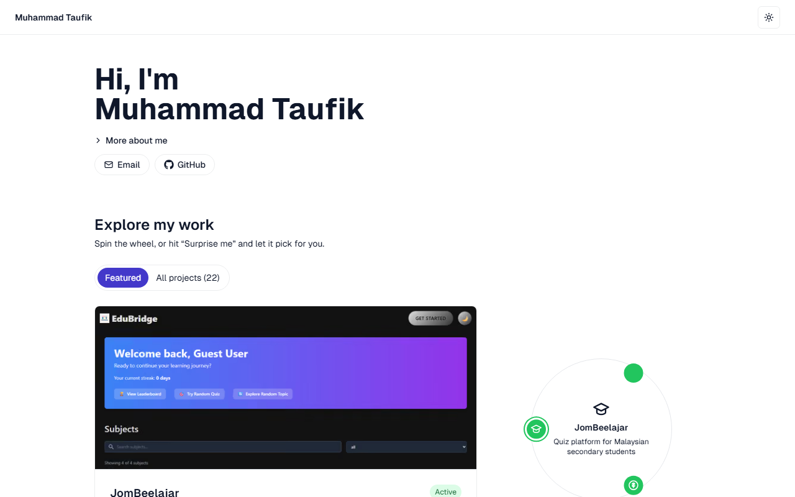
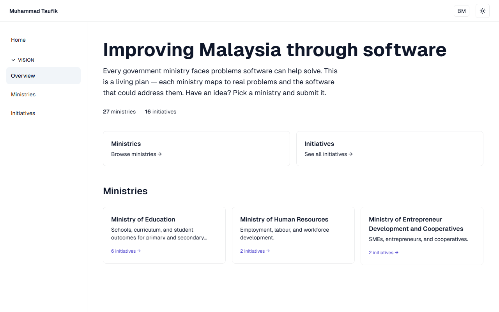
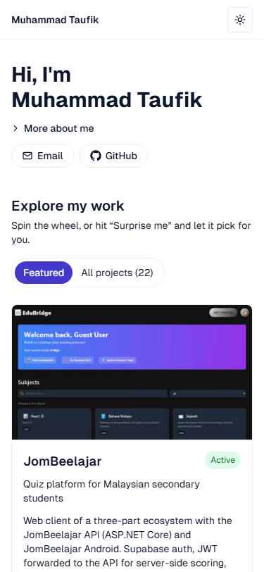

# taufikhamid

[](https://github.com/taufikhamid2000/taufikhamid/actions/workflows/ci.yml)

Personal portfolio and project showcase for Taufik Hamid, plus a small owner-only CMS and a bilingual "Vision for Malaysia" planning section.

Live: https://taufikhamid.com

Stack: Next.js 16 (App Router, Server Actions) + React 18 + TypeScript 5 + Tailwind CSS 3 + three.js; Supabase (Postgres with Row Level Security, Auth) for data; Anthropic Claude (Haiku) for EN->BM translation; GitHub Actions for CI; Vercel for hosting. Requires Node >= 24 (`engines` in `package.json`). How the pieces fit: [docs/ARCHITECTURE.md](docs/ARCHITECTURE.md).

## What's in it

- **Public home page** (`app/page.tsx`) — hero, contact links, and project cards read from Supabase `public.projects`. Featured projects are shown as highlights; the rest are collapsed behind "View all projects".
- **Owner admin** (inside the home-page app, `app/pes/`) — CRUD for project cards, sprint/task planning, moderation of community idea submissions, and a one-click Bahasa Malaysia backfill ("Translate missing" in the Inbox screen). Reads are public; writes are gated to a single owner email. `ADMIN_EMAIL` in `lib/auth.ts` is the app-level check (`requireOwner()` runs at the top of every mutating Server Action) and the same email is hardcoded into every "Admin can write ..." RLS policy in `supabase/migrations/`, so the app and the database cannot drift apart. Login is at `/login` (email/password or Google via Supabase Auth); password reset lives under `app/auth/`.
- **Vision** (`/vision`, Malay at `/ms/vision`) — public planning pages that map Malaysian government ministries to problems and software ideas. Anyone can submit an idea (anonymous, honeypot-protected, stored as `pending`); it appears only after the owner approves it. UI strings live in `lib/i18n.ts`; content translations are `_ms` columns on `ministries`/`initiatives`, filled by `lib/translate.ts` (Claude Haiku via `@anthropic-ai/sdk`).
- **InteractiveReflection** (`app/projects/InteractiveReflection/`) — a small self-contained interactive demo (React hooks, keyboard navigation, CSS transitions). The only subproject still embedded in the portfolio; everything else was migrated out to standalone repos in May 2026 (see `docs/REPOSITORY_AUDIT.md`).

Other bits: `proxy.ts` (Next 16's middleware equivalent) refreshes the Supabase session on every request; `app/sitemap.ts` and `app/robots.ts` generate SEO files from `lib/site-url.ts`; light/dark/system theme is a cookie set by `app/actions/theme.ts`.

## Screenshots







## AI translation pipeline

`lib/translate.ts` (`server-only`) exports `translateToMalay(text)`, which sends the text to Claude Haiku 4.5 (`claude-haiku-4-5`) through `@anthropic-ai/sdk`, with a system prompt asking for formal Bahasa Malaysia, product/brand names and URLs kept verbatim, and the translation returned with no preamble. Empty input is returned as-is; the key comes from `ANTHROPIC_API_KEY`.

It is called only from `translateMissingAction` in `app/pes/admin-actions.ts`. That action checks `getIsOwner()` before anything else (it spends paid API credits), then finds `ministries` rows missing `name_ms`/`description_ms` and `initiatives` rows missing `problem_ms`/`idea_ms`, translates just the missing fields, and writes them back to Supabase. It then revalidates `/ms/vision` and `/`, and returns the count of rows updated; a missing API key is reported as a readable error.

## How I use AI here and what I check

AI is used in two places. Claude Haiku translates Vision content into Bahasa Malaysia (`lib/translate.ts`), and I use Claude Code to help write and refactor code in this repo.

What I check:

- **Offline translation checker** (`lib/translation-eval.ts`, run with `npm run eval:translations`). Given source/translated pairs it flags empty output, output identical to the source, changed or dropped URLs, placeholders, markup and numbers, product/brand names not kept verbatim, extreme length drift (a rough ratio band, which also catches truncation), and preamble or quote wrapping. It needs no API key and never calls the API. CI runs it on a small fixture set of made-up pairs, some deliberately bad (`scripts/fixtures/translation-pairs.json`), plus unit tests (`npm test`). Pass your own JSON file of pairs to check real output.
- **Human review.** These are structural checks only. They say nothing about whether the Malay is good. Translations are written to the database by the owner-only "Translate missing" action, and I read them on `/ms/vision` before relying on them. The checker is not yet wired into that action, so it does not block a bad translation from being saved.
- No accuracy figures are claimed; none have been measured.
- For code, CI (lint, typecheck, tests, build) must pass, and I review diffs before pushing.

## Local development

```bash
cp .env.example .env.local   # then fill in the values below
npm install
npm run dev                  # http://localhost:3000
npm run lint                 # eslint app lib scripts proxy.ts
npm run typecheck            # tsc --noEmit
npm test                     # unit tests for the translation checker (node:test)
npm run eval:translations    # offline translation checks on fixture pairs
npm run build                # what Vercel runs
```

Environment variables:

| Variable | Required | Used by |
|---|---|---|
| `NEXT_PUBLIC_SUPABASE_URL` | yes | all Supabase clients in `lib/supabase/` |
| `NEXT_PUBLIC_SUPABASE_ANON_KEY` | yes | anon/publishable key, same clients. Legacy name `NEXT_PUBLIC_SUPABASE_KEY` is still accepted as a fallback. |
| `ANTHROPIC_API_KEY` | only for "Translate missing" | `lib/translate.ts` (read implicitly by the Anthropic SDK; not in `.env.example`) |
| `NEXT_PUBLIC_SITE_URL` | no | `lib/site-url.ts`; falls back to `VERCEL_URL`, then `http://localhost:3000` |

You can run the public site and admin reads with just the two Supabase variables. Writes require signing in as `ADMIN_EMAIL`.

## Data and migrations

All application data lives in the hosted Supabase project (schema `public`): `projects`, `sprints`, `tasks`, `ministries`, `initiatives`, `submissions`. Project cards on the home page are simply rows in `public.projects`; `image_url` is an optional path to a screenshot under `public/screenshots/<slug>.png` (referenced as `/screenshots/<slug>.png`), falling back to a gradient header when null.

Conventions for `supabase/migrations/`:

- Every change is a timestamped SQL file (`YYYYMMDDHHMMSS_snake_case_title.sql`) and is applied to the hosted project via the Supabase CLI (`supabase db push`, config in `supabase/config.toml`) or the SQL editor. There is no local Postgres in the loop.
- Schema and *content* both go through migrations. Card copy, sprint/task status updates, and even bookkeeping notes ("SBMP migrated out", "MyQuiza live-verified") are committed as `update public.projects ...` / `update public.tasks ...` files, so the git history doubles as a changelog.
- Files are idempotent where practical (`if not exists`, `drop policy if exists`, `where status <> 'done'`) and carry a header comment explaining the why.
- RLS is the security boundary: public `select` policies, owner-email `insert/update/delete` policies. If the owner email ever changes, update `lib/auth.ts` and add a migration that recreates the policies (see `20260519130000_update_admin_email.sql`).

`types/supabase.d.ts` holds the generated database types.

## Project structure

```
app/
  page.tsx, layout.tsx      home page + root layout (SiteShell sidebar, theme)
  _components/              shared UI: Hero, ProjectCardTilt, Reveal, TiltWrapper, ShaderBackground, theme-toggle, ...
  actions/theme.ts          theme cookie Server Action
  admin/                    CMS: projects CRUD, sprints/, submissions/, translations/
  auth/                     Supabase auth callbacks, reset/update password
  login/                    email/password + Google sign-in
  vision/                   Vision for Malaysia (EN): ministries, initiatives, [slug], submit action
  ms/vision/                same pages, Malay locale
  projects/InteractiveReflection/   embedded demo
  robots.ts, sitemap.ts
lib/
  auth.ts                   ADMIN_EMAIL, getIsOwner(), requireOwner()
  supabase/                 server / client / public / middleware clients
  projects.ts, sprints.ts, tasks.ts, vision.ts   typed data access
  i18n.ts, translate.ts     locale strings; Claude-backed EN->BM translation
  site.ts, site-url.ts, theme.ts, types.ts
supabase/
  config.toml               CLI config (project id, auth redirect URLs)
  migrations/               timestamped schema + content migrations
public/screenshots/         project card images referenced by projects.image_url
types/supabase.d.ts         generated DB types
proxy.ts                    session-refresh middleware (Next 16 naming)
docs/REPOSITORY_AUDIT.md    cross-repo audit (May 2026) + status updates
```

## Deployment

Hosted on Vercel; every push to `main` auto-deploys to https://taufikhamid.com. Set the environment variables above in the Vercel project (only `ANTHROPIC_API_KEY` is secret). Supabase Auth redirect URLs for production and localhost are listed in `supabase/config.toml` and must match the hosted project's Auth settings.
